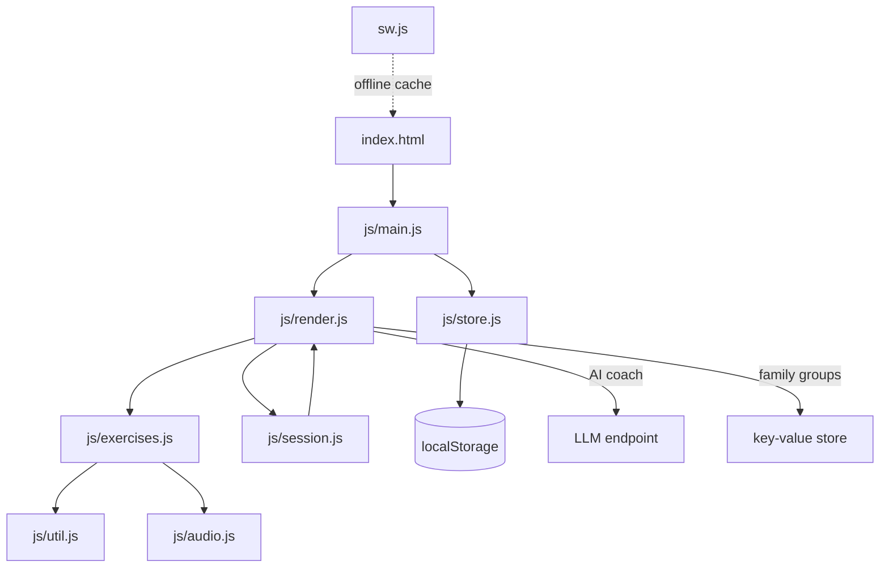

# 毎日のうトレ (Mainichi Noutore)

> 60歳の親のために作った、毎日つづけられる脳トレ PWA


A daily brain-training web app built to help older adults keep their minds active.
Designed for a parent about to turn 60 — simple enough to use every day on a phone,
grounded in published research on dementia risk reduction.

**Live demo:** <https://mainichi-noutore-jqbzcccl.devinapps.com>

## What it does

- **Daily habit checks** — the lifestyle factors that make up the biggest share of
  dementia risk (aerobic exercise, fish and vegetables, sleep, social contact,
  alcohol, smoking). One tap each.
- **Cognitive benchmarks** — 14 short exercises (~7 minutes total) that measure
  processing speed, working memory, executive function, and verbal fluency.
  Each one can be run individually, with an annotated demo video and spoken
  instructions so first-time users aren't lost.
- **Trend tracking** — per-domain score graphs and weekly reports, so gradual
  change is visible instead of a single number.
- **AI coach** — turns recent records into concrete suggestions for next week,
  generated in-app.
- **Family groups** — a 6-letter code lets family members see each other's
  streaks and scores inside the app.
- **Streaks and badges** — small nudges that keep the habit going.

## Demo videos

Short clips for each exercise are in the repo root (`demo-*.mp4`).

| Exercise | Demo |
| --- | --- |
| Dual Task | [▶ demo-dual.mp4](demo-dual.mp4) |
| N-back | [▶ demo-nb.mp4](demo-nb.mp4) |
| Stroop | [▶ demo-stroop.mp4](demo-stroop.mp4) |
| Trail Making | [▶ demo-tmt.mp4](demo-tmt.mp4) |
| Visual Search | [▶ demo-vs.mp4](demo-vs.mp4) |
| Delivery Route | [▶ demo-ds.mp4](demo-ds.mp4) |

The remaining clips (`demo-calc`, `demo-dd`, `demo-mk`, `demo-pl`, `demo-st`,
`demo-sym`, `demo-vf`, `demo-wr`) follow the same pattern.

## The exercises

| Exercise | Domain | Demo |
| --- | --- | --- |
| Double Attention | processing speed | `demo-dd.mp4` |
| Quick Math | processing speed | `demo-calc.mp4` |
| N-back | working memory | `demo-nb.mp4` |
| Monkey Test | spatial memory | `demo-mk.mp4` |
| Dual Task | divided attention | `demo-dual.mp4` |
| Stroop | inhibition | `demo-stroop.mp4` |
| Verbal Fluency | vocabulary, speech input | `demo-vf.mp4` |
| Visual Search | attention switching | `demo-vs.mp4` |
| Digit Span (backward) | working memory | `demo-ds.mp4` |
| Word Recall | memory retention | `demo-wr.mp4` |
| Trail Making (number–kana) | executive function | `demo-tmt.mp4` |
| Digit–Symbol Coding | processing speed | `demo-sym.mp4` |
| Shiritori | vocabulary, retrieval speed | `demo-st.mp4` |
| Delivery Route | planning, executive function | `demo-pl.mp4` |

## Architecture



- **No frameworks, no build step** — plain HTML/CSS/ES modules, served as static files.
- State lives in `localStorage` under a single versioned key, validated on load.
- The service worker caches the app shell and all JS modules for offline use.
- Family sharing uses an opaque 6-letter code; the AI coach sends only numeric scores.

## Run locally

ES modules require HTTP (opening `index.html` via `file://` will not work).

```bash
python3 -m http.server 8000
# open http://localhost:8000
```

Any static server works:

```bash
npx serve .
```

## Deploy

Upload the repository root to any static host (GitHub Pages, Netlify, Vercel,
Cloudflare Pages). No environment variables or server-side runtime are required.

If you change the cached asset list, bump the cache name in `sw.js` so existing
users receive the new version.

## Project structure

```
index.html          app shell
styles.css          all styling
manifest.json       PWA manifest
sw.js               service worker / offline cache
js/
├── main.js         entry point, service-worker registration
├── util.js         DOM, date and math helpers
├── store.js        localStorage state, streaks, family helpers
├── audio.js        Web Audio feedback tones
├── exercises.js    14 cognitive exercises
├── session.js      session flow, timers, speech
└── render.js       home, reports, guide, coach UI
demo-*.mp4          annotated exercise demos
```

## Privacy

- All personal records stay in the browser (`localStorage`).
- No account is required.
- Family sharing sends only the data needed for streaks and scores, keyed by the
  group code.
- The AI coach sends aggregated numeric records, not free-text personal data.

## Research it draws on

- Livingston et al., *The Lancet* (2020/2024) — modifiable dementia-risk factors
- The ACTIVE trial — speed-of-processing training effects
- The Synapse Project — learning new skills vs. games alone
- WAIS Digit–Symbol and Trail Making Test conventions for the benchmark tasks
